# 多租户 CRM SaaS 平台

一个基于 Laravel 13 的多租户 CRM（客户关系管理）SaaS 平台，灵感来自 HubSpot 的简化版实现。

## 技术栈

| 分类 | 技术 |
|------|------|
| 后端框架 | Laravel 13.17 |
| PHP | 8.4+ |
| 前端驱动 | Livewire 4.4 + Volt 1.11 |
| 数据库 | MySQL 8.4 |
| UI | Tailwind CSS |
| 本地环境 | ServBay |
| 队列/缓存 | Laravel 默认（数据库/文件） |

## 功能截图

<p align="center">
  <b>仪表板</b><br>
  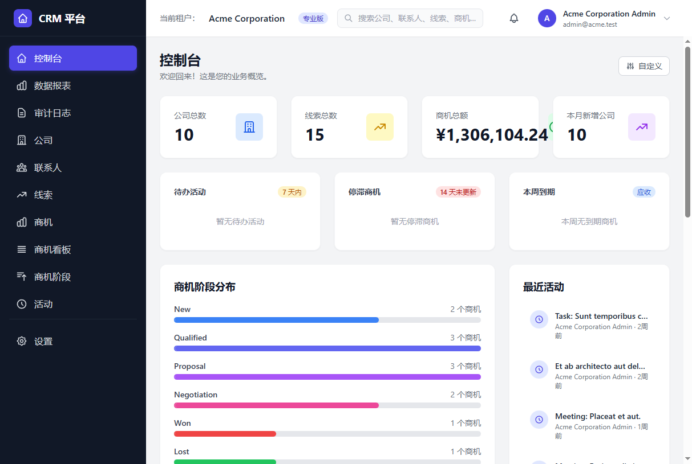<br><br>
  <b>销售漏斗看板（Kanban 拖拽）</b><br>
  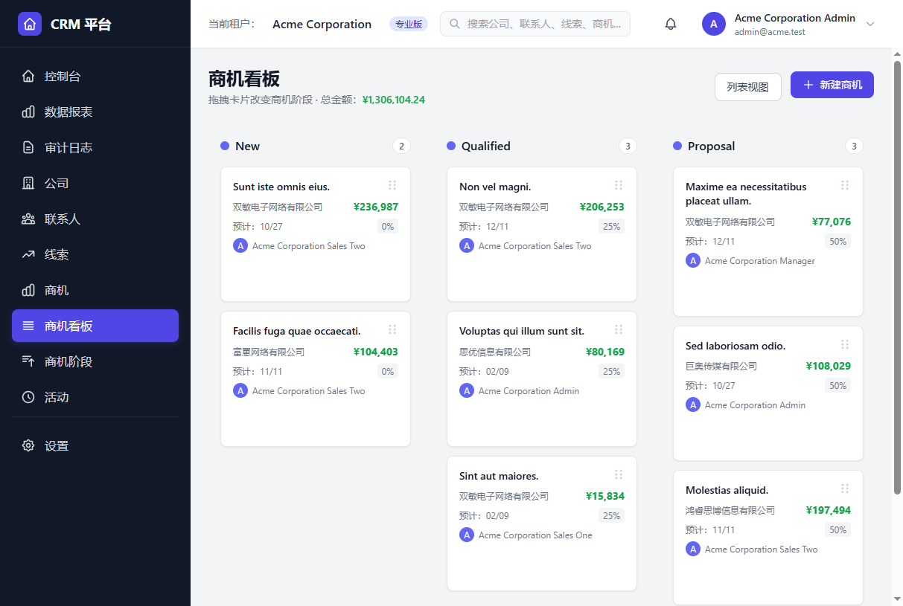<br><br>
</p>

### 核心 CRM

<p align="center">
  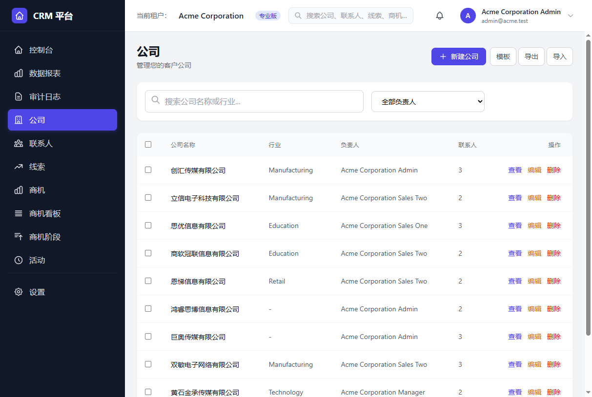
  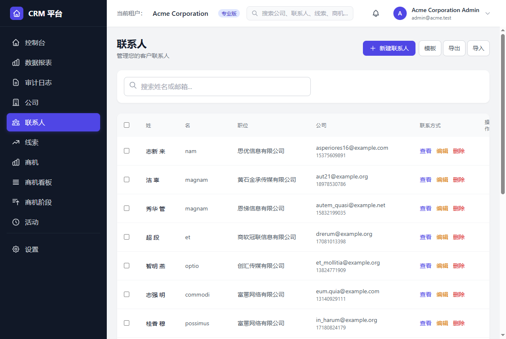<br>
  <sub>客户公司管理 &nbsp;·&nbsp; 联系人</sub><br><br>
  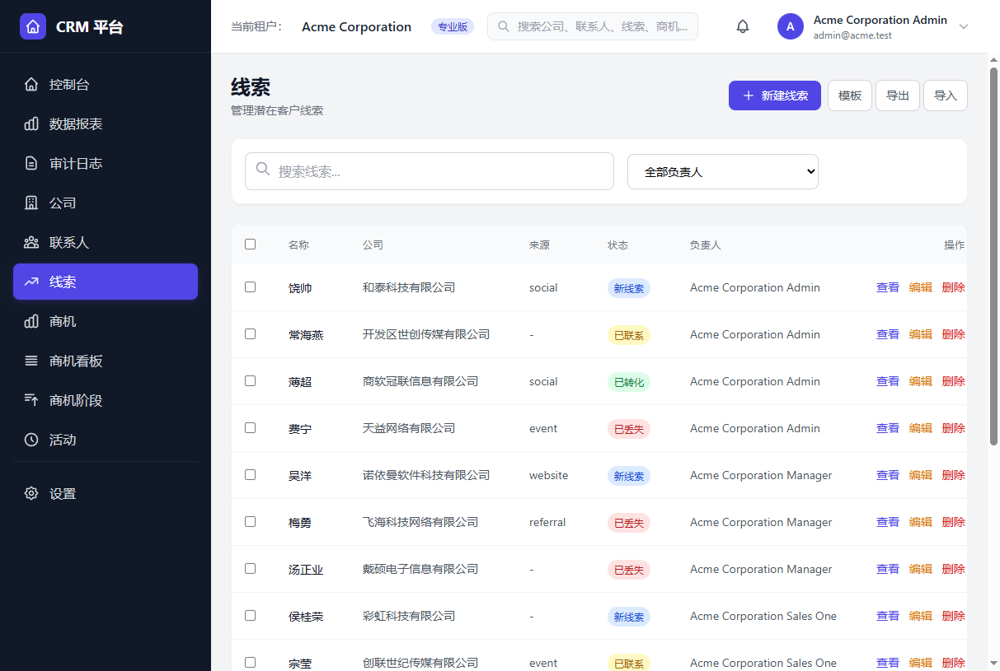
  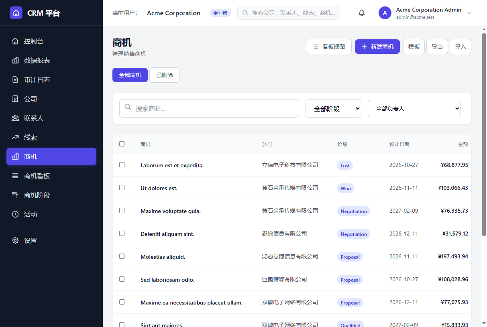<br>
  <sub>线索池 &nbsp;·&nbsp; 商机管理</sub>
</p>

### 报表与通知

<p align="center">
  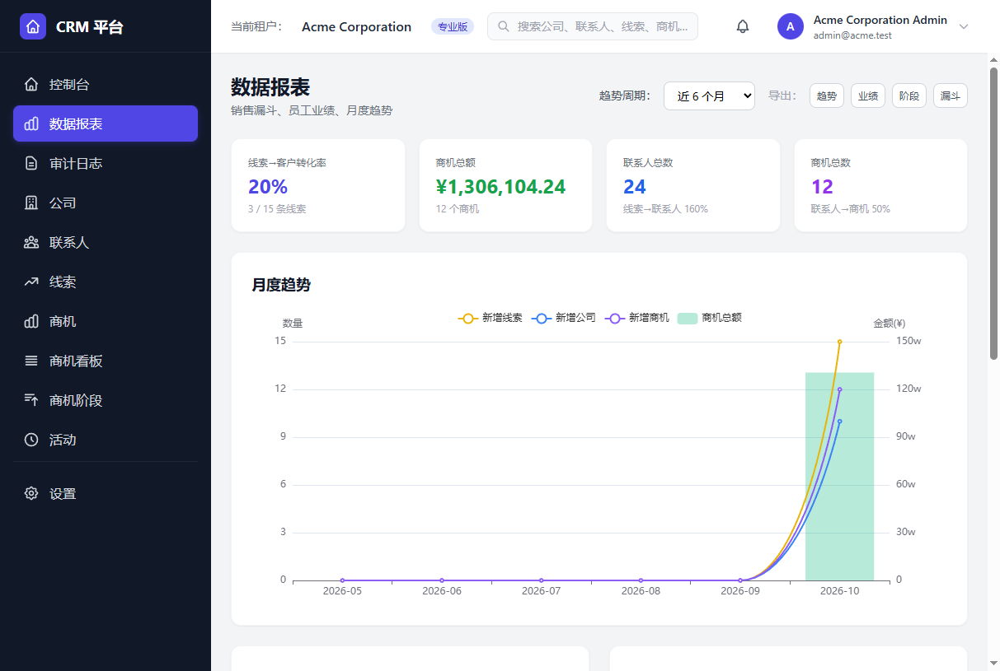<br>
  <sub>数据报表（漏斗转化率 · 月度趋势 · 阶段分布）</sub><br><br>
  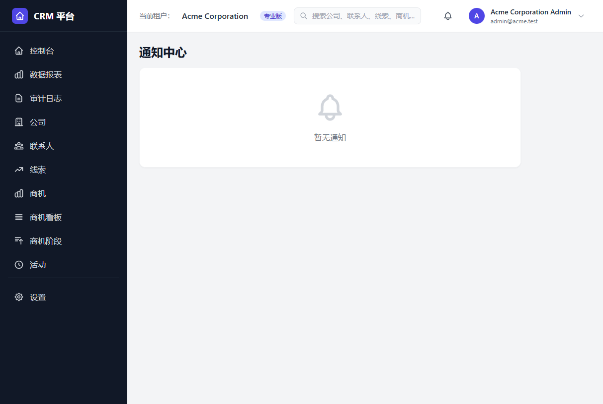
  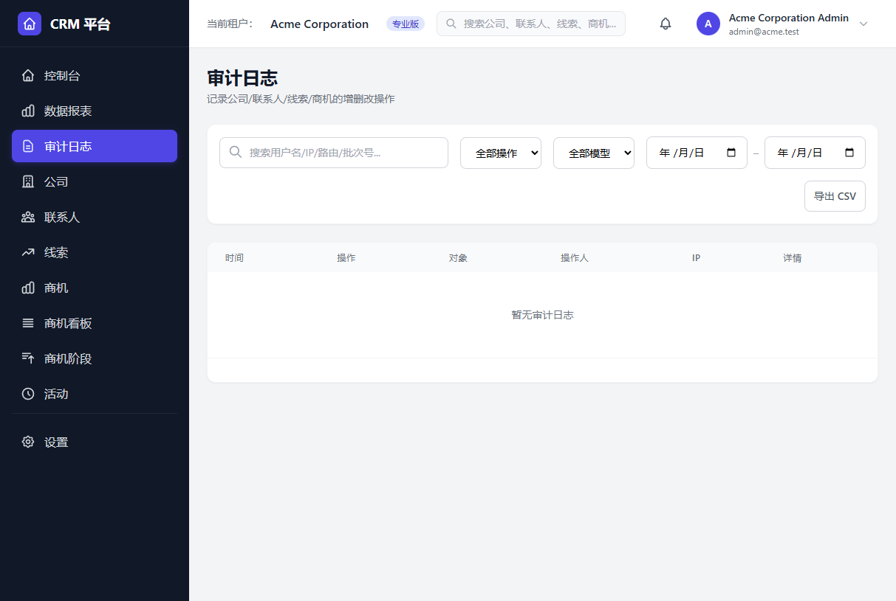<br>
  <sub>通知中心 &nbsp;·&nbsp; 审计日志（字段级 diff）</sub>
</p>

### 设置与管理后台

<p align="center">
  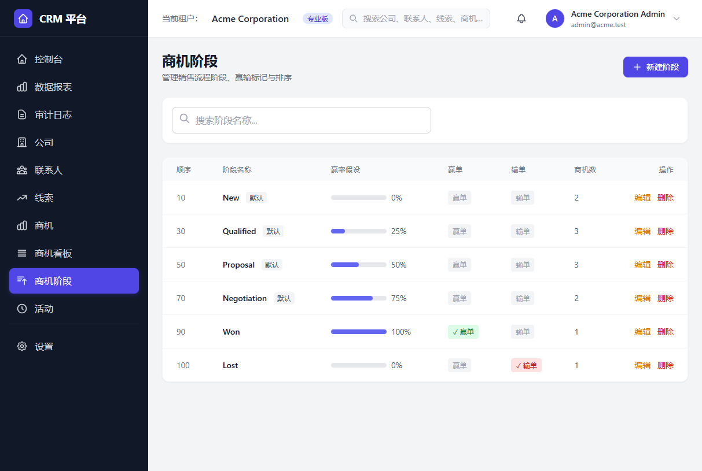
  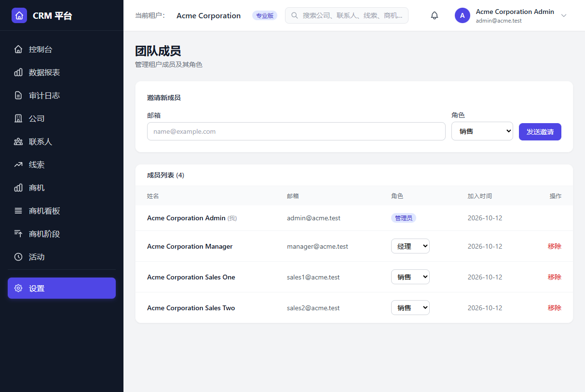<br>
  <sub>销售阶段配置 &nbsp;·&nbsp; 团队成员与邀请</sub><br><br>
  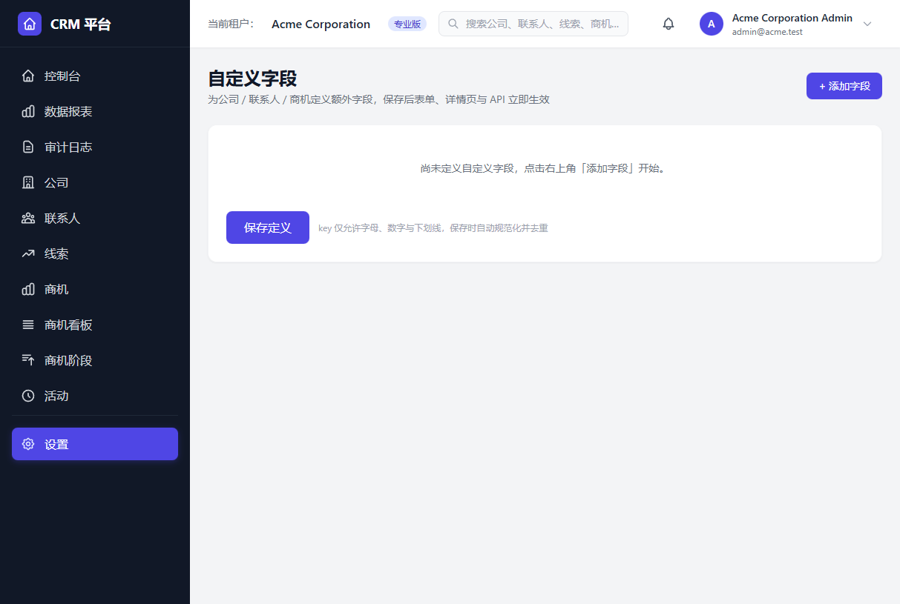
  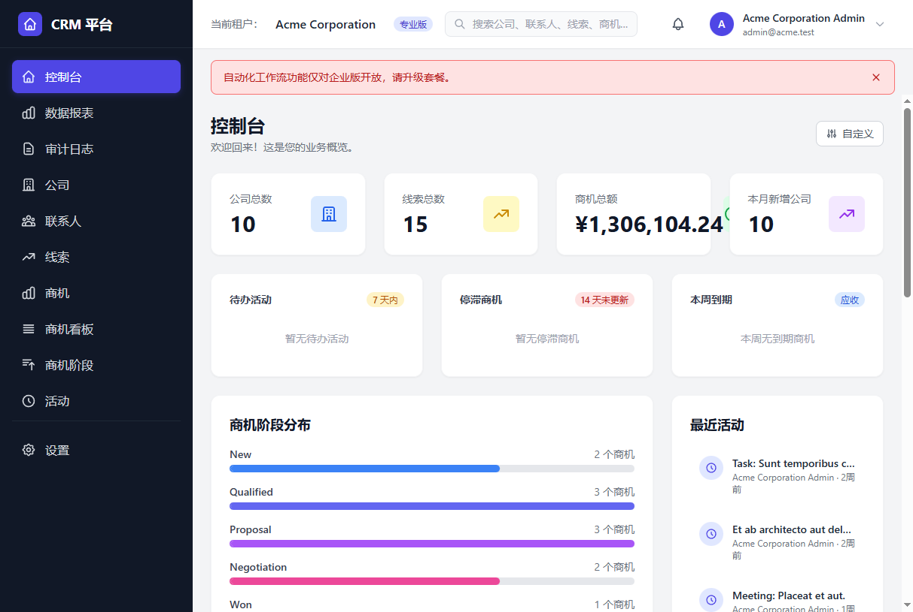<br>
  <sub>自定义字段 &nbsp;·&nbsp; 自动化工作流引擎</sub><br><br>
  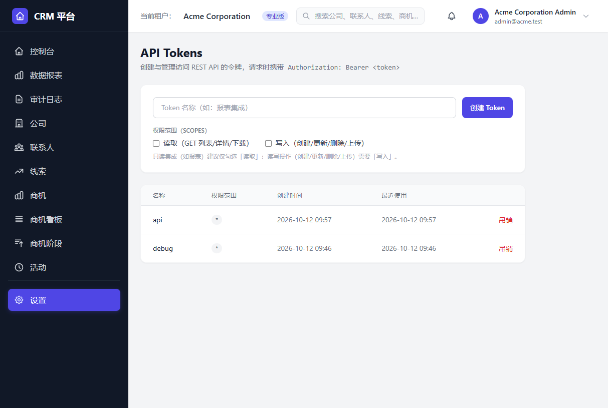
  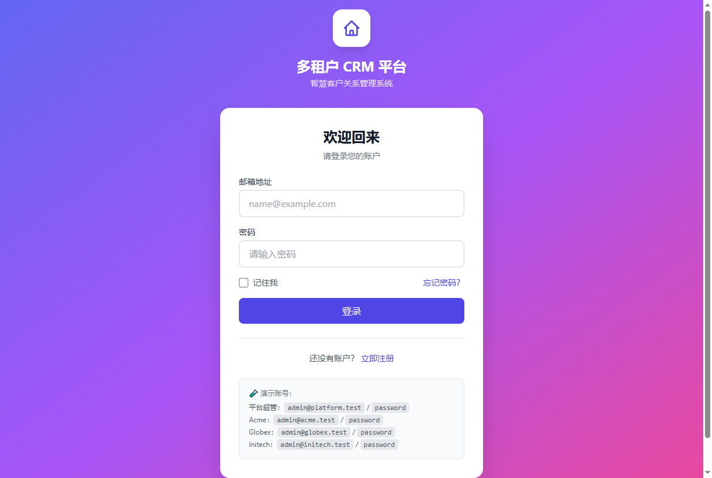<br>
  <sub>API Tokens 管理 &nbsp;·&nbsp; 登录页</sub>
</p>

## 核心功能

| 模块 | 功能要点 |
|------|----------|
| **多租户隔离** | 单库 + `tenant_id` 全局 TenantScope 自动注入；console/Tinker 安全逃生舱；子域名租户识别 |
| **客户公司** | CRUD、行业分类、负责人分配、附件、自定义字段、查重与合并 |
| **联系人** | 关联公司、多联系人归属、附件、自定义字段、查重与合并 |
| **线索 Leads** | 来源追踪、状态流转、一键转商机、公共 web-to-lead 表单（蜜罐防滥用） |
| **商机 Opportunities** | 金额/赢单概率/预计成交日期、智能评分、自定义字段、批量改阶段/负责人 |
| **销售漏斗** | Kanban 看板拖拽移动；租户级阶段可配置、有序排列 |
| **跟进活动** | 多态关联（morphs）、时间线聚合展示、过期提醒、无活动自动提醒 |
| **仪表板** | KPI 卡片、阶段分布、待我处理（7 天到期/14 天无更新）、可自定义小组件 |
| **数据报表** | ECharts 图表（漏斗/趋势/阶段）、按人业绩、CSV 一键导出 |
| **搜索** | 顶栏全局跨实体搜索（FULLTEXT 驱动 + ngram 分词）、列表高级筛选排序 |
| **通知体系** | 站内信 + 邮件 + 群机器人（钉钉/企微/Slack）、用户级偏好、冷却去重 |
| **审计日志** | 字段级 before/after diff、批量操作 batch_id 聚合、CSV 导出、gzip 归档 + 保留策略 |
| **CSV 导入导出** | UTF-8 BOM 兼容 Excel、关联名称自动解析、大文件队列异步导入 + 进度表 |
| **权限控制** | RBAC 三角色（admin/manager/sales）、sales 数据权限隔离、API Token scope（read/write） |
| **自定义字段** | 6 种类型（文本/数字/日期/下拉/多选/长文本）、必填验证、列表/API 筛选 |
| **自动化** | 工作流引擎（事件驱动 + 条件匹配 + 动作执行）、租户规则可视化编辑 |
| **REST API** | Sanctum Token 认证、`/api/v1` 完整 CRUD、Swagger UI 交互式文档、全局限流 |
| **Webhook** | 5 个业务模型 CRUD 事件推送、HMAC-SHA256 签名、队列化、推送可观测 |
| **商业化** | Stripe Checkout + Customer Portal、发票同步 + 账单历史、套餐配额检查、试用到期提醒 |
| **智能化** | 智能商机评分（多维度加权 + 停滞惩罚）、LLM AI 跟进建议与活动摘要、静默降级 |
| **安全** | 邮箱验证、2FA（RFC 6238 TOTP + 8 恢复码）、子域名归属校验、数据权限 |
| **平台超管** | 租户管理（新建/禁用/套餐变更）、配额使用率监控、MRR/流失看板、错误事件面板 |
| **工程化** | GitHub Actions CI、错误监控聚合告警、PWA 离线横幅、性能基准命令 + 复合索引 |

<details>
<summary><b>查看完整 Phase 分级功能清单</b></summary>

### Phase 1 — 生产加固
- **邮箱验证** — 注册后自动发送验证邮件，未验证用户无法进入业务区
- **团队邀请流程** — 管理员通过 email 发送邀请链接，被邀请人注册后自动加入租户
- **商机软删除恢复** — 已删除商机 tab + 恢复 + 彻底删除
- **审计日志 diff 对比** — 展开详情时显示字段级 before/after diff，变更行高亮
- **仪表板待我处理** — 7 天内到期活动 / 14 天未更新商机 / 本周到期商机
- **商机无活动提醒** — 超过 N 天无活动跟进的商机自动通知（可配置阈值）
- **邮件通知渠道** — 所有提醒可叠加发邮件（config 开关）

### Phase 2 — 业务升级
- **跟进时间线** — 公司/联系人/商机详情页聚合展示活动历史，类型图标 + 状态徽章
- **高级筛选/排序** — 列表页表头点击排序、搜索、负责人筛选（白名单防注入）
- **批量改阶段/负责人** — 商机列表批量操作，走 AuditService::withBatch 审计
- **数据权限细化** — sales 仅可见/操作自己负责的数据（列表/详情/报表同步收紧）
- **附件管理** — 公司/联系人/商机上传附件（私有磁盘存储，10MB 限制）

### Phase 3 — 商业化扩展
- **REST API** — Sanctum Token 认证 + `/api/v1` 完整 CRUD，租户隔离自动生效
- **API 跨租户隔离验证** — Sanctum → BootstrapTenancy → TenantScope 完整链路
- **Webhook 事件推送** — 5 个业务模型的 CRUD 事件自动推送，HMAC-SHA256 签名
- **邮件转线索** — Mailgun/SendGrid Inbound Parse → 自动创建 Lead
- **Stripe 订阅计费** — Checkout Session 创建 + Webhook 事件同步租户状态

### Phase 4 — 智能化
- **智能商机评分** — 多维度加权评分（金额/阶段/活跃度/紧迫度/停滞惩罚，权重可配置），`crm:refresh-scores` 批量刷新
- **LLM 通用适配器** — 兼容 OpenAI 及各类兼容接口（阿里云百炼 / DeepSeek / 硅基流动），无配置时静默降级
- **AI 跟进建议** — 根据商机上下文生成跟进邮件草稿（限流 10 次/分钟，prompt 自动截断）
- **自动化工作流引擎** — 事件驱动规则（created/updated/entered_stage/stalled），支持条件匹配与动作执行（create_activity / notify_owner / set_stage / set_probability），规则存于 config/workflows.php

### Phase 5 — 生产化扩展
- **工作流规则租户化** — 规则存入 tenant_workflows 表（TenantScope 隔离），Settings 页可视化编辑，与 config 示例规则双层共存
- **机器人 Webhook 通知** — 钉钉 / 企业微信 / Slack 自定义机器人渠道（config 开关，无配置静默跳过）
- **全局跨实体搜索** — 顶栏搜索框一键检索公司 / 联系人 / 线索 / 商机，租户隔离 + sales 数据权限同步生效
- **Webhook 推送队列化** — `CRM_WEBHOOK_QUEUE` 开关，SendWebhookJob 队列任务（tries=3 + backoff），默认同步旁路
- **API 限流** — 登录/注册 10 次/分钟/IP，认证端点 60 次/分钟/用户，防暴力破解
- **推送可观测** — Webhook 管理页展示失败计数 / 最近失败时间 / 最近响应；工作流列表展示最近触发时间

### Phase 6 — 完整度加固
- **REST API 补全** — Stages / Users 只读端点、附件 multipart 上传（10MB + 类型白名单 + morph 校验）
- **Webhook Secret 脱敏** — API 响应默认隐藏签名密钥，仅创建时一次性返回
- **Stripe Customer Portal** — 订阅页一键跳转自助管理账单/支付方式；past_due 状态横幅提示
- **试用到期提醒** — 试用期剩余 ≤3 天时通知租户 admin 与平台超管（冷却去重 + 可静音）
- **用户级通知偏好** — 「设置 → 通知偏好」按类型开关站内信/邮件提醒
- **平台超管面板增强** — 各租户配额使用率、成员数、最近活跃一目了然
- **审计日志导出与保留策略** — 高级筛选结果一键导出 CSV（含 batch_id / IP / before/after）；`crm:prune-audit-logs` 定时清理
- **租户数据导出/删除（GDPR）** — 平台面板一键导出全租户数据 ZIP（8 表 CSV）或清除业务数据（保留审计）
- **API Token 自助管理** — 「设置 → API Tokens」创建（明文一次性展示）/ 列表 / 吊销
- **报表可视化 + CSV 导出** — ECharts 趋势/漏斗图表 + 趋势/业绩/阶段/漏斗四类数据一键导出
- **商机评分骤降提醒** — `crm:refresh-scores` 刷新时降幅超阈值自动通知负责人（冷却去重 + 可静音）
- **两步验证（2FA）** — 无依赖 RFC 6238 TOTP（兼容 Google Authenticator 等）+ 8 个用后即焚恢复码；登录挑战页校验，恢复码丢失可重新生成
- **子域名租户识别** — 配置 `CRM_SUBDOMAIN_ROOT` 后 `acme.crm.example.com` 自动锁定租户上下文，归属校验防跨租户访问
- **自定义字段** — 租户自定义为公司/联系人/商机增加业务字段（6 种类型 + 必填验证 + 列表/API 筛选），专业版及以上
- **数据查重** — 公司按名称 / 联系人按邮箱：表单实时查重提示（非阻塞）、CSV 导入重复行自动跳过计数
- **新手引导** — 仪表板快速上手 checklist（建公司→录联系人→录线索→转商机→邀请成员），完成后自动隐藏、可手动关闭
- **AI 活动摘要** — 详情页一键生成跟进历史要点（限流 + 缓存 + prompt 截断 + 静默降级）
- **工作流扩展** — 新增 `send_webhook` 动作（复用 WebhookService，失败旁路化）与条件匹配模式 `all/any`
- **API Token scope** — 创建 Token 可勾选 read/write 权限范围，中间件按 HTTP 方法校验 ability（GET→read、写→write），只读集成最小授权
- **界面多语言（i18n）** — 内置中文（默认）/ 英文两套界面语言，顶栏一键切换存 `users.locale`

### Phase 7 — 工程化与商业化闭环
- **GitHub Actions CI** — push/PR 自动跑全量测试（PHP 8.4 + sqlite :memory:），绿灯才可合并
- **错误监控 ErrorReporter** — 异常聚合签名 + 冷却去重后推送群机器人告警（`crm.error_alerts` 配置）
- **Stripe 发票同步 + 账单历史** — `invoice.paid/payment_failed` 幂等入 `tenant_invoices`，订阅页展示近 12 期账单与支付状态
- **公共线索表单（web-to-lead）** — 租户生成 `/f/{uuid}` 公开表单，蜜罐防滥用 + 限流 + 套餐配额前置检查，游客提交直达线索池
- **重复数据合并** — 公司/联系人同名候选检测，空字段回填 + 自定义字段合并 + 关联对象迁移，事务 + batch_id 审计

### Phase 8 — 体验与运营
- **仪表板自定义小组件** — 4 个可配置区块（待办/分析/最近商机/高分商机），开关状态存 `users.dashboard_widgets`
- **PWA** — manifest + Service Worker（静态资源 cache-first、离线回退页），移动端可安装
- **租户白标 SMTP** — 租户配置自有 SMTP 与发件人身份，提醒/邀请邮件从租户品牌发出；运行时切换 mailer 且长驻 worker 复位隔离
- **平台收入/流失看板** — MRR/ARPU、付费/试用租户、累计流失率、近 12 个月发票收入按月按币种汇总

### Phase 9 — 开放与性能
- **OpenAPI 3.0 规范 + 交互式文档** — `php artisan api:generate-docs` 生成规范，`/api/docs` Swagger UI 在线调试、`/api/openapi.json` 供 SDK 导入
- **性能基准与索引评估** — `crm:benchmark` 六类核心查询路径计时（--json 可脚本化），补充 5 组复合索引并输出查询→索引映射表

### Phase 10 — 性能与体验 / 平台能力
- **Stripe 事件队列化** — webhook 回调同步入队后由 `ProcessStripeEvent` 消费，回调端零阻塞、失败自动重试
- **CSV 大文件后台导入** — 超过阈值行数自动转 `ImportCsvJob` 队列处理，进度表实时展示已处理/成功/失败行数
- **全局搜索 FULLTEXT 驱动** — MySQL FULLTEXT + ngram 分词（BOOLEAN MODE），非 mysql 连接自动回退 LIKE
- **错误事件 DB 聚合 + 平台错误面板** — 异常按签名聚合计数落库，超管面板查看 TOP 错误与首次/最近发生时间
- **审计日志归档** — `crm:archive-audit-logs` 先 gzip 导出再删除过期记录，每日 08:05 调度
- **邮件模板品牌化** — vendor 邮件视图（页眉/页脚/署名/标题）统一使用租户白标或平台品牌名
- **套餐多币种** — 计划级 `currency` 配置，平台收入看板 MRR 按币种分组展示
- **PWA 离线提示** — 全局离线横幅（online/offline 事件实时切换），断网页面导航回退离线页

</details>

## 快速开始

```bash
# 1. 克隆代码
git clone <your-repo> crm
cd crm

# 2. 安装依赖
composer install

# 3. 复制环境变量
cp .env.example .env
php artisan key:generate

# 4. 编辑 .env（重点项）
#   DB_DATABASE=crm
#   DB_USERNAME=root
#   DB_PASSWORD=你的密码
#   APP_URL=http://crm.servbay.host

# 5. 迁移并填充演示数据
php artisan migrate:fresh --seed

# 6. 在 ServBay 中添加网站
#    域名：crm.servbay.host
#    Root 指向：项目目录的 public/
#    PHP 版本：8.4+

# 7. 访问 http://crm.servbay.host
```

## 演示账号

| 角色 | 邮箱 | 密码 | 租户 |
|------|------|------|------|
| 平台超管 | `admin@platform.test` | `password` | — |
| 租户 admin | `admin@acme.test` | `password` | Acme Corporation（pro） |
| 租户 admin | `admin@globex.test` | `password` | Globex Industries（enterprise） |
| 租户 admin | `admin@initech.test` | `password` | Initech Solutions（free，trial 已过期） |

> 平台超管登录后进入 `/platform/tenants` 管理租户。
> 租户用户登录后自动进入自己的 CRM 仪表板，数据被严格隔离。

## 架构一句话

**单库 + `tenant_id` 列 + 全局 `TenantScope` + `BelongsToTenant` Trait + `Tenancy` 单例服务。**

登录时中间件把当前用户注入 Tenancy，Tenancy 单例持有当前租户 ID，TenantScope 在每次查询自动附加 `WHERE tenant_id = ?`，业务模型通过 Trait 在创建时自动填 tenant_id。Seeder/Tinker 等 console 环境下 Tenancy::id() 为 null → Scope 逃生舱自动关闭 → 正常工作。

详细设计见 [docs/architecture.md](docs/architecture.md)。

## 更多文档

- [架构详解](docs/architecture.md)
- [数据库设计](docs/database.md)
- [本地环境搭建](docs/setup.md)
- [部署手册（生产上线/备份/监控）](docs/deployment.md)
- [套餐与配额体系](docs/plans.md)
- [通知体系（提醒/渠道/偏好）](docs/notifications.md)
- [全局搜索](docs/search.md)
- [自定义字段](docs/custom-fields.md)
- [租户数据导出与删除（GDPR）](docs/gdpr.md)
- [CSV 导入导出](docs/csv.md)
- [数据报表](docs/reports.md)
- [审计日志](docs/audit.md)
- [REST API 文档](docs/api.md)
- [REST API 交互式文档（OpenAPI）](docs/api-reference.md)
- [错误监控](docs/monitoring.md)
- [Stripe 发票与账单历史](docs/billing.md)
- [公共线索表单（web-to-lead）](docs/web-form.md)
- [重复数据合并](docs/merge.md)
- [仪表板自定义小组件](docs/dashboard-widgets.md)
- [PWA](docs/pwa.md)
- [租户白标 SMTP](docs/white-label.md)
- [平台收入/流失看板](docs/platform-revenue.md)
- [性能基准与索引评估](docs/performance.md)
- [Webhook 集成](docs/webhook.md)
- [Stripe 订阅计费](docs/stripe.md)
- [LLM 集成](docs/llm.md)
- [自动化工作流](docs/workflow.md)
- [商机智能评分](docs/scoring.md)
- [安全设计（2FA / Token / 安全要点）](docs/security.md)
- [界面多语言（i18n）](docs/i18n.md)
- [配置参考](docs/config.md)

## License

MIT
